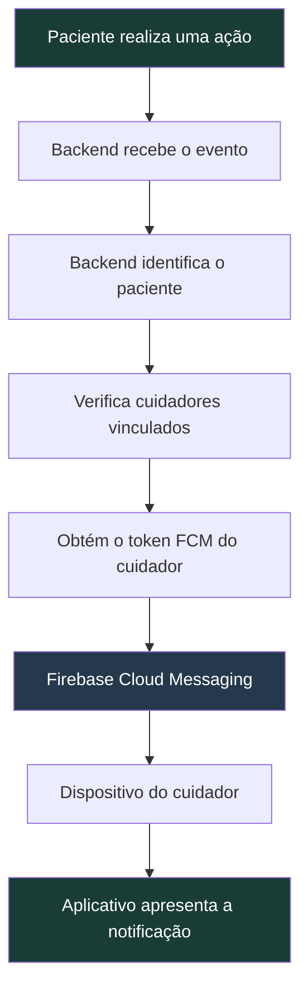
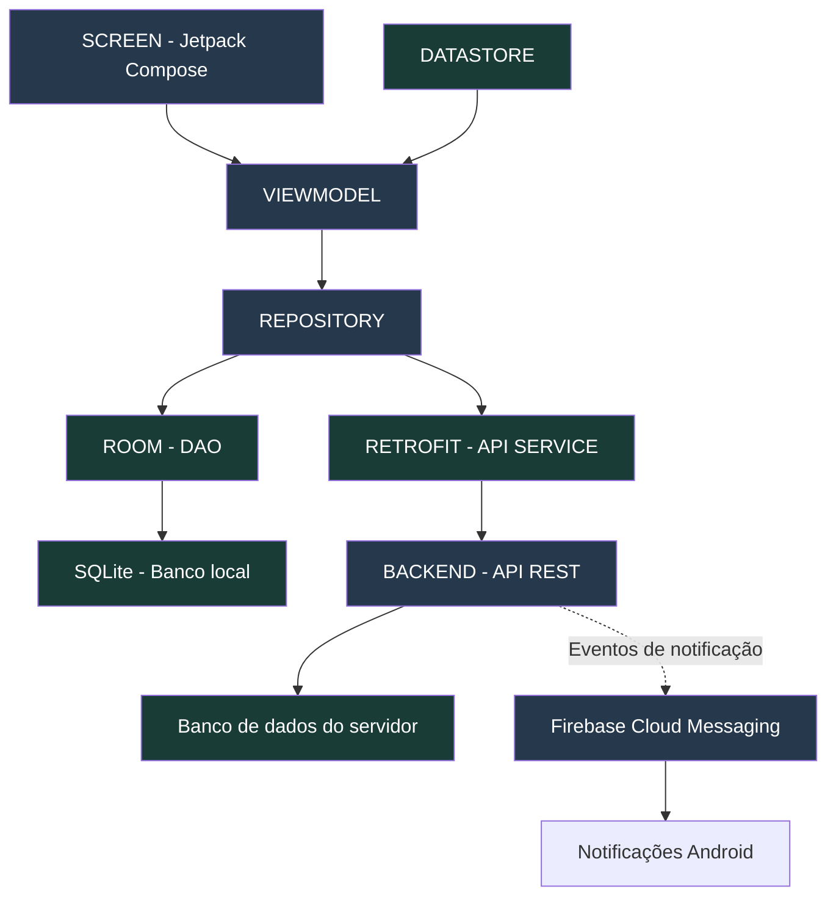

# 💊 DOSY
### Sistema Inteligente de Apoio ao Uso de Medicamentos

O **DOSY** é um aplicativo mobile desenvolvido para auxiliar pacientes no gerenciamento, organização e acompanhamento de suas rotinas de medicamentos.

A aplicação oferece recursos para cadastro de medicamentos, configuração de horários, lembretes, acompanhamento de doses, histórico de utilização e monitoramento da adesão ao tratamento.

Um dos principais diferenciais do projeto é a possibilidade de vincular pacientes a cuidadores, permitindo que familiares ou responsáveis acompanhem informações relacionadas à rotina de medicamentos.

🚧 **Projeto em desenvolvimento**

O DOSY está sendo desenvolvido por uma equipe de cinco estudantes de Engenharia da Computação, utilizando tecnologias Android e uma arquitetura organizada em camadas, com integração a uma API e serviços de notificações.

---

## 🎓 Origem do projeto

O DOSY surgiu como parte de uma disciplina de **Projeto Multidisciplinar**, componente curricular do curso de Engenharia da Computação.

A proposta da disciplina é proporcionar aos estudantes a oportunidade de desenvolver uma solução tecnológica para um problema real, aplicando conhecimentos adquiridos ao longo da graduação.

A equipe identificou a necessidade de uma ferramenta que facilitasse a organização do uso de medicamentos, principalmente para pessoas que precisam seguir tratamentos com horários e dosagens específicas.

A partir dessa necessidade, foi idealizado o DOSY: uma solução mobile que combina desenvolvimento Android, engenharia de software, integração entre sistemas, banco de dados e serviços de notificações.

Além da construção da aplicação, o projeto envolve planejamento, documentação, desenvolvimento colaborativo, controle de versão e integração entre diferentes componentes de software.

---

## 🎯 Objetivos

O principal objetivo do DOSY é facilitar o gerenciamento da rotina de medicamentos, proporcionando maior organização e acompanhamento do tratamento.

A aplicação busca:

- 💊 Permitir o cadastro e gerenciamento de medicamentos;
- ⏰ Organizar horários e dosagens;
- 🔔 Disponibilizar lembretes de medicamentos;
- ✅ Registrar doses e acompanhar suas situações;
- 📅 Consultar a programação de medicamentos;
- 📊 Acompanhar indicadores de adesão;
- 📖 Consultar o histórico de utilização;
- 👨‍👩‍👧 Permitir o vínculo entre pacientes e cuidadores;
- 📲 Enviar notificações relacionadas ao acompanhamento;
- 🔐 Gerenciar usuários e suas permissões.

---

## 📱 Funcionalidades

### 🏠 Início

Apresenta um resumo da rotina de medicamentos do paciente.

Informações disponíveis:

- Medicamentos programados;
- Horários de administração;
- Situação das doses;
- Indicadores de adesão ao tratamento;
- Informações relacionadas ao acompanhamento.

### 💊 Medicamentos

Permite gerenciar os medicamentos utilizados pelo paciente.

- Cadastro de medicamentos;
- Edição e exclusão;
- Nome e dosagem;
- Múltiplos horários;
- Frequência de utilização;
- Data de início e término;
- Observações.

### 📅 Calendário

Permite visualizar a programação dos medicamentos de acordo com as datas, facilitando a organização da rotina.

### 📖 Histórico

Centraliza os registros relacionados à utilização dos medicamentos.

Entre as informações acompanhadas estão:

- Doses tomadas;
- Doses pendentes ou não tomadas;
- Horário programado;
- Horário de confirmação;
- Registros por período.

### 📊 Adesão ao tratamento

Apresenta indicadores relacionados ao cumprimento da rotina de medicamentos.

A proposta é utilizar os registros de doses programadas e suas respectivas situações para calcular a porcentagem de adesão ao tratamento.

### 👨‍👩‍👧 Paciente e cuidador

O DOSY possui dois perfis principais de utilização.

**Paciente**

É o responsável pelos próprios dados e pela administração de sua rotina.

Pode:

- Gerenciar medicamentos;
- Configurar horários;
- Registrar doses;
- Consultar histórico;
- Acompanhar indicadores;
- Solicitar vínculo com um cuidador.

**Cuidador**

É responsável pelo acompanhamento de um paciente vinculado.

Pode:

- Visualizar os medicamentos do paciente;
- Consultar horários programados;
- Acompanhar a situação das doses;
- Receber notificações relacionadas ao paciente;
- Acompanhar informações da rotina de utilização.

O cuidador possui acesso de acompanhamento, respeitando as permissões estabelecidas pelo sistema. O gerenciamento dos medicamentos permanece sob responsabilidade do paciente.

**Fluxo de vinculação:**

1. O paciente solicita o vínculo com um cuidador.
2. O cuidador recebe a solicitação.
3. O cuidador aceita a solicitação.
4. O sistema estabelece o vínculo entre os usuários.
5. O cuidador passa a visualizar as informações do paciente autorizado.

---

## 🔔 Sistema de notificações

O DOSY utiliza uma estrutura de notificações que combina lembretes no dispositivo e notificações push.

O objetivo é auxiliar o paciente a lembrar dos horários dos medicamentos e permitir que o cuidador receba informações importantes sobre o acompanhamento.

### 1. Lembretes do paciente

O aplicativo trabalha com lembretes relacionados aos horários programados dos medicamentos.

O fluxo geral é:

1. O paciente cadastra um medicamento.
2. Define os horários de administração.
3. O aplicativo organiza os lembretes correspondentes.
4. No horário programado, o dispositivo apresenta uma notificação.
5. O paciente pode acessar o aplicativo para acompanhar e registrar a situação da dose.

### 2. Notificações push para o cuidador

Para a comunicação entre dispositivos, o projeto utiliza o **Firebase Cloud Messaging (FCM)**.

Diferentemente dos lembretes locais, as notificações push permitem que um dispositivo receba informações enviadas pelo backend, mesmo quando o aplicativo não está aberto.

O funcionamento envolve:

1. O cuidador realiza o login no aplicativo.
2. O dispositivo obtém seu token de registro do Firebase Cloud Messaging.
3. O aplicativo disponibiliza esse token para o backend.
4. O backend associa o dispositivo ao usuário correspondente.
5. Quando ocorre um evento relacionado ao acompanhamento do paciente, o backend identifica o cuidador vinculado.
6. O servidor solicita o envio de uma notificação ao Firebase Cloud Messaging.
7. O FCM encaminha a mensagem ao dispositivo do cuidador.
8. O aplicativo recebe e apresenta a notificação.

### Fluxograma das notificações push

**Tecnologias envolvidas:**

- Firebase Cloud Messaging: entrega de notificações push;
- Backend: processamento dos eventos e identificação dos destinatários;
- DataStore: gerenciamento de informações da sessão;
- Android: recebimento e apresentação das notificações.

A persistência de uma central de notificações, com consulta de registros e controle de leitura, também faz parte da evolução da integração com o backend.

---

## 🏗️ Arquitetura do aplicativo

O DOSY utiliza o padrão arquitetural **MVVM (Model-View-ViewModel)** em conjunto com o padrão Repository.

Essa arquitetura organiza o código em responsabilidades separadas, evitando que as telas precisem conhecer diretamente os detalhes de comunicação com o servidor ou do armazenamento local.

### Fluxograma da arquitetura

### Como funciona cada camada?

**1. Screen (View)**

É a camada de interface desenvolvida com Jetpack Compose.

Responsabilidades:

- Construir as telas;
- Apresentar informações;
- Capturar interações do usuário;
- Observar os estados disponibilizados pelo ViewModel.

As Screens não devem acessar diretamente o banco de dados ou realizar requisições HTTP.

**2. ViewModel (VM)**

É responsável por gerenciar os estados e as ações de cada tela.

Responsabilidades:

- Receber eventos das Screens;
- Solicitar operações aos Repositories;
- Processar informações necessárias para a apresentação;
- Disponibilizar estados para a interface;
- Controlar estados de carregamento, sucesso e erro.

A comunicação entre Screen e ViewModel permite que a interface seja atualizada conforme os dados mudam.

**3. Repository**

É a camada responsável por centralizar o acesso aos dados.

Ela faz a comunicação entre os ViewModels e as fontes de dados disponíveis.

No DOSY, o Repository coordena o acesso ao armazenamento local e aos serviços remotos, evitando que a lógica de acesso aos dados fique espalhada pelas telas.

**4. DAO e Room**

O Room é utilizado para persistência local, enquanto os DAOs definem as operações de acesso às entidades armazenadas.

O banco local utiliza SQLite.

O projeto adota uma abordagem offline-first, utilizando o armazenamento local como referência para os dados disponibilizados à interface e coordenando a sincronização com o servidor.

**5. Retrofit e API Service**

O Retrofit é utilizado para realizar a comunicação HTTP entre o aplicativo Android e o backend.

Os serviços definem as operações disponíveis para comunicação com a API.

O Repository utiliza esses serviços para enviar e receber informações, como dados de usuários, medicamentos e registros de utilização.

**6. DataStore**

O DataStore é utilizado para armazenar informações relacionadas à sessão do usuário.

Entre os dados gerenciados estão:

- Identificação do usuário;
- Token de autenticação;
- Tipo de usuário;
- Identificação do paciente vinculado;
- Informações básicas da conta.

Essas informações permitem que o aplicativo identifique se o usuário está utilizando o perfil de paciente ou cuidador.

**7. Backend e banco de dados**

O backend é responsável pelo processamento das requisições, validação das operações e gerenciamento dos dados compartilhados entre os dispositivos.

O aplicativo não acessa diretamente o banco de dados remoto. A comunicação acontece por meio da API REST.

---

## 🔄 Fluxo de comunicação entre as camadas

Para compreender a arquitetura, é importante entender como uma operação acontece dentro do aplicativo.

O fluxo padrão segue esta sequência:

1. O usuário realiza uma ação em uma Screen.
2. A Screen comunica o evento ao ViewModel.
3. O ViewModel solicita a operação ao Repository.
4. O Repository consulta a fonte de dados apropriada.
5. O resultado retorna ao ViewModel.
6. O ViewModel atualiza o estado da tela.
7. O Jetpack Compose identifica a alteração e atualiza a interface.

Esse processo permite que as responsabilidades permaneçam separadas, facilitando a manutenção e a evolução do sistema.

---

## 🌐 Integração com API

O DOSY possui integração com um backend por meio de uma **API REST**.

A API funciona como intermediária entre o aplicativo Android e o banco de dados remoto, centralizando o processamento das operações.

A comunicação é realizada utilizando Retrofit, com requisições HTTP e troca de informações em formato JSON.

Entre as responsabilidades da API estão:

- Autenticação de usuários;
- Gerenciamento de pacientes e cuidadores;
- Cadastro e gerenciamento de medicamentos;
- Consulta de informações;
- Registro de utilização dos medicamentos;
- Gerenciamento dos vínculos entre usuários;
- Integração com serviços de notificações.

A comunicação entre o aplicativo e o backend é organizada por meio de Repositories e serviços específicos, mantendo a interface independente dos detalhes da API.

> A implementação do backend é desenvolvida separadamente do aplicativo Android, permitindo que as duas partes evoluam de forma independente, respeitando os contratos de comunicação estabelecidos.

---

## 📴 Persistência e funcionamento offline

O DOSY utiliza Room e SQLite para armazenamento local.

Essa estrutura permite que informações sejam disponibilizadas no dispositivo sem depender exclusivamente de uma consulta ao servidor a cada interação.

O DataStore complementa essa estrutura, armazenando informações relacionadas à sessão do usuário.

A estratégia offline-first busca oferecer uma experiência mais consistente, organizando a persistência local e a sincronização com o backend.

---

## 🛠️ Tecnologias utilizadas

| Tecnologia | Finalidade |
|---|---|
| Kotlin | Linguagem principal |
| Android Studio | Ambiente de desenvolvimento |
| Jetpack Compose | Construção das interfaces |
| Material 3 | Componentes e identidade visual |
| MVVM | Organização da arquitetura |
| ViewModel | Gerenciamento de estados |
| Repository Pattern | Organização do acesso aos dados |
| Retrofit | Comunicação com API |
| Room | Persistência local |
| SQLite | Banco de dados local |
| DataStore | Gerenciamento de sessão |
| Firebase Cloud Messaging | Notificações push |
| Git | Controle de versão |
| GitHub | Colaboração e gerenciamento do código |

---

## 👨‍💻 Equipe

O DOSY está sendo desenvolvido por cinco estudantes de Engenharia da Computação.

O trabalho envolve colaboração entre os integrantes nas diferentes etapas do desenvolvimento, incluindo:

- Desenvolvimento Android;
- Desenvolvimento e integração com backend;
- Modelagem e gerenciamento de dados;
- Engenharia de software;
- Interface e experiência do usuário;
- Integração de serviços;
- Testes e documentação;
- Controle de versão.

---

## 📚 Aprendizados e conhecimentos aplicados

O desenvolvimento do DOSY proporciona a aplicação prática de conhecimentos adquiridos ao longo da graduação.

Entre os principais conceitos envolvidos estão:

- Programação orientada a objetos;
- Desenvolvimento mobile;
- Arquitetura MVVM;
- Padrão Repository;
- Banco de dados relacionais;
- Persistência local;
- APIs REST;
- Comunicação entre sistemas;
- Autenticação e gerenciamento de sessão;
- Notificações push;
- Desenvolvimento colaborativo;
- Engenharia de software.

---

## 📌 Repositório

Este repositório contém o desenvolvimento da aplicação Android do DOSY, incluindo sua arquitetura, interfaces, integração com API e funcionalidades de acompanhamento de medicamentos.

O projeto continua em desenvolvimento e recebe atualizações conforme a evolução das funcionalidades e integrações.

**DOSY — Tecnologia a favor do cuidado e da organização da saúde.**

---

### 📄 Licença

Este projeto está sendo desenvolvido para fins acadêmicos e educacionais, como parte de uma disciplina de Projeto Multidisciplinar do curso de Engenharia da Computação.
